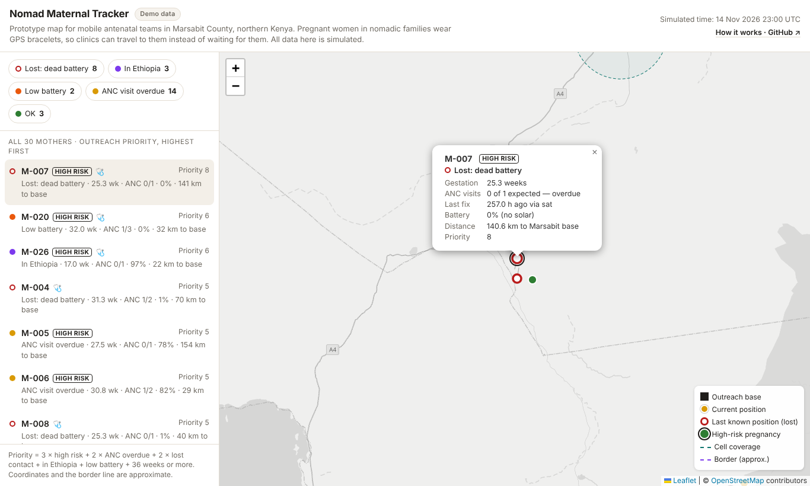
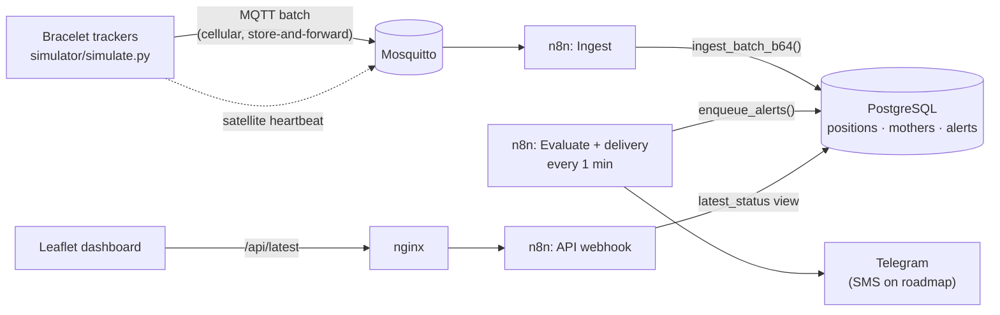

# Nomad Maternal Tracker

[](https://github.com/se-xy/nomad-maternal-tracker/actions/workflows/verify.yml)

**A tracking and alerting system for mobile antenatal care among nomadic pastoralist communities in arid northern Kenya.**
Research prototype with simulated devices and synthetic data.

**Current development:** redesigned outreach dashboard, explicit simulation clock, durable alert queue, importable n8n templates, and matched communication-policy experiments. Read [implementation status](docs/implementation-status.md) and [research results](docs/research.md) for verification boundaries.



**Live demo (synthetic data):** https://se-xy.github.io/nomad-maternal-tracker/

---

## Why

In Marsabit County (about 66,000 km², largely desert and semi-desert), many families are nomadic pastoralists who move between water points and grazing land. Pregnant women often miss the recommended antenatal care (ANC) visits because the nearest dispensary may be days away, and the family has already moved on by the next visit.

A pilot in Moyale sub-county, led by epidemiologist Dahabo Adi, turned the model around: expectant mothers wore GPS trackers hidden in traditional beaded bracelets, and mobile clinical teams drove to wherever the women were. The pilot reported three problems that limit this approach: **dead batteries** make mothers disappear from the system, **families cross into Ethiopia** where Kenyan teams cannot follow, and the system needs to **scale beyond the pilot**. ([source video](https://www.youtube.com/watch?v=CKkGJWm68pc))

This project is an independent, open-source software reimplementation of that idea. It does not cover the hardware. The focus is on the problems above, under realistic desert conditions.

## What it does

* **Simulates** bracelet trackers for 30 mothers moving through two migration ranges (Chalbi desert and the Moyale area), including heat, sparse network coverage and border crossings.
* **Ingests** device data over MQTT. Points recorded offline arrive late via store-and-forward and are merged idempotently.
* **Decides** each mother's status in SQL: lost (dead battery vs. out of coverage), across the border, low battery, ANC overdue. It also ranks mothers by **outreach priority**.
* **Alerts** field teams on Telegram only when something *changes*, including "back in Kenya" and "back in contact" messages.
* **Shows** a map for the outreach team with a prioritised list, last-known positions, coverage zones and the nearest base.

## Designed for the region, not just placed on a map

| Constraint in northern Kenya | Design decision |
|---|---|
| Cellular signal only near a few towns | **Store-and-forward**: the device keeps up to 7 days of hourly fixes in flash and uploads the backlog when it reaches a tower |
| Large areas with no signal at all | **Satellite heartbeat** every 6 h (latest position only, 85% success) so the team still knows roughly where a mother is |
| Desert heat (~23 °C night, ~39 °C afternoon) shortens battery life | Battery drain increases by 5% per °C above 30 °C; modem network-search cost is modelled |
| Strong sun all year | **Solar charging** for half the fleet, reduced by panel dust (60–100% efficiency) |
| Dead battery and no signal look identical (silence) | `LOST_CONTACT` alerts say which one is *likely*, based on the last reported battery level |
| Families cross into Ethiopia near Moyale | Border geofence: `CROSSED_BORDER` alert, then a "back in Kenya" alert so a team can meet her |
| Long distances, few roads | Distance to the nearest outreach base in every alert, plus a priority score for planning the day's route |
| Duplicate delivery (satellite + later cellular batch) | `UNIQUE (device_id, recorded_at)` makes ingestion idempotent |

## Architecture



Core decision logic (status, priority, alert opening/resolving) lives in **PostgreSQL** (`db/01_schema.sql`). The n8n workflows are thin: one trigger, one SQL call, one output. This keeps the logic testable and version-controlled. In this prototype the satellite path goes through the same broker; a real deployment would receive it from the satellite provider's API.

## What the simulation shows

`python simulator/simulate.py --dry-run` (14 days, 30 devices, seed 42, reproducible):

| | Device uptime | Time in cell coverage |
|---|---|---|
| Solar bracelets (16) | **100%** | 33% |
| Non-solar bracelets (14) | **53%** | 44% |

* Without solar, a device is dead about half the time, even with recharging at town kiosks. This supports the original project's goal of moving to solar-powered units.
* Data volume: 2,878 cellular batches + 719 satellite heartbeats ≈ **1.2 KiB per device per day**. Connectivity cost is small; coverage is the real problem.
* 639 fixes were lost because solar devices stayed out of coverage for more than 7 days and the buffer overflowed. This is a concrete argument for a larger flash buffer or a satellite *batch* option.
* In a typical run about one third of stored fixes arrive late via store-and-forward. Without that design they would be lost.

> These figures come from my model's assumptions (listed in `simulator/simulate.py`, `P` dict), not from field data. They show how the design behaves; they do not measure the real world.

## Quick start

Requirements: Docker + Docker Compose, Python 3.10+.

```bash
cp .env.example .env                      # set POSTGRES_PASSWORD
docker compose up -d                      # Mosquitto, Postgres (auto-loads db/*.sql), n8n, dashboard
# import and configure the five workflow templates: see workflows/README.md
pip install -r simulator/requirements.txt
python simulator/simulate.py --speed 1    # 1 simulated hour per second; 14 days ≈ 6 min
```

* Dashboard: http://localhost:8080 (shows explicit offline state if the API is unavailable; add ?demo=1 for synthetic demo)
* n8n: http://localhost:5678

Other modes:

```bash
python simulator/simulate.py --dry-run     # offline run: prints statistics, writes dashboard/demo-data.json
python simulator/simulate.py --write-sql   # regenerate db/02_seed.sql from geo/region.json (+ --mothers/--seed)
```

## Testing

Every push runs the [Verify prototype](.github/workflows/verify.yml) workflow on GitHub Actions (PostgreSQL 16 + headless Chromium):

| Test | Checks |
|---|---|
| `tests/test_simulator.py` | Simulator unit tests |
| `tests/db_parity_test.py` | Replays a 14-day simulation through `ingest_batch_b64()` exactly as n8n would; the SQL `latest_status` view must match the simulator's model for every mother, with no duplicate open alerts |
| `tests/db_edges.sql` | Duplicate points ignored, invalid latitude rejected, lost contact detected when the clock advances, alert queue deduplicated, wrong delivery token refused |
| `tests/ui_logic.cjs` | Dashboard data coercion, search, HTML escaping, outage and recovery logic |
| `tests/ui.cjs` | Desktop and mobile browser checks: 30 mothers listed, search, no horizontal overflow, API outage then recovery |
| `experiments/run.py --seeds 2` | Experiment smoke run |

```bash
python -m unittest discover -s tests -p 'test_*.py'
PGURL=postgresql://nmt:<password>@localhost:5432/postgres python tests/db_parity_test.py
# status/priority mismatches: 0/30   duplicate open alerts: 0
```

## Repository layout

```
docker-compose.yml     Mosquitto · Postgres · n8n · nginx
geo/region.json        bases, coverage zones, waypoints, border line (single source of truth)
simulator/             device simulator (MQTT, dry-run, seed generator)
db/                    schema + logic (01), generated seed data (02)
workflows/             five importable n8n templates (inactive, not yet run in n8n) + guide
dashboard/             single-file Leaflet map + demo data
experiments/           communication-policy experiment (run.py, summarise.py, results.csv)
docs/                  research notes, implementation status, screenshots
tests/                 simulator, database, SQL edge-case and browser tests
.github/workflows/     CI: runs all tests on every push
```

## Research experiment

The matched 270-trial study compares cellular-only, fixed hybrid and adaptive hybrid communication. It reports both energy and location-freshness trade-offs: [methods and results](docs/research.md). These are separate from the original demo run above.

## Why the data is simulated

Real tracking and health records of pregnant women in Marsabit are **not available to this project and could not be published even if they were**:

* **Legal:** health and location data are sensitive personal data under Kenya's Data Protection Act (2019). Using them requires informed consent, a lawful purpose, ethics approval and agreement with the county health authorities.
* **Security:** the data would reveal where vulnerable women and their families are, in a remote border region. If leaked, that information could put people at risk, so it should never sit in a public repository or a public demo.
* **Access:** the original pilot's data belongs to that programme, and this is an independent student project with no data-sharing agreement.

So every person, device, movement and health record here is **synthetic**. The project demonstrates the *design* (how data would flow, be checked, prioritised and alerted on) and how it behaves under modelled desert conditions. It does **not** demonstrate real-world accuracy or health impact. Validating it with real data would be a separate phase, done only with the approvals above, on secured infrastructure.

## Privacy and ethics

The real version of this system would hold the **live location of pregnant women from a marginalised community**. Under Kenya's Data Protection Act (2019), health data is sensitive personal data. This prototype:

* uses **synthetic data only**; no real person is represented;
* stores mothers under **pseudonyms** (`M-001`) with no names, phone numbers or ID numbers;
* keeps location tables separate from identity, so access can be restricted per role.

A real deployment would also need: informed consent in the local language (and the right to remove the bracelet at any time), encryption in transit (MQTT over TLS) and at rest, per-device credentials, role-based access, retention limits on location history, and agreement with county health authorities. Location data like this could put people at risk if leaked, so the threat model matters as much as the features.

## Limitations

* **All data is simulated** (see [Why the data is simulated](#why-the-data-is-simulated)); model parameters for movement, battery, solar and satellite success are assumptions, not field measurements.
* Coordinates, coverage radii and the border line are **approximate** and hand-entered.
* Movement is a simple waypoint model, not based on real migration data.
* ANC visits are seeded, not recorded; the schedule uses the 4-visit model mentioned in the pilot (WHO's 2016 guidance recommends at least 8 contacts). The priority rule is illustrative, not clinically validated.
* **Not yet run end to end:** the Docker Compose stack, the n8n workflow templates (never imported into a real n8n) and Telegram delivery. Everything else is covered by the automated tests below.
* MQTT and n8n run without authentication or TLS; ports are bound to localhost only (local demo, never real data).

## Roadmap

- [ ] Record ANC visits from the field (form or USSD) and the postnatal phase (newborn vaccination follow-up)
- [ ] SMS alerts via Africa's Talking for teams without smartphones
- [ ] Clustering of movement history (DBSCAN) to suggest **pop-up clinic locations**
- [ ] Daily outreach route planning (OSRM / OR-Tools) by priority and distance
- [ ] Official boundary data and real coverage maps
- [ ] TLS + per-device credentials on the broker; role-based access on the API
- [ ] Configurable ANC schedule (4-visit vs. WHO 8-contact model)

## Acknowledgement

Inspired by the maternal GPS-tracking pilot in Moyale, Marsabit County, led by Dahabo Adi. This repository is an independent learning project and is not affiliated with that initiative.

## Author

**Peter Robia Mwaniki**, BSc Computer Science, University of Dunaújváros.
Licensed under the MIT License.

